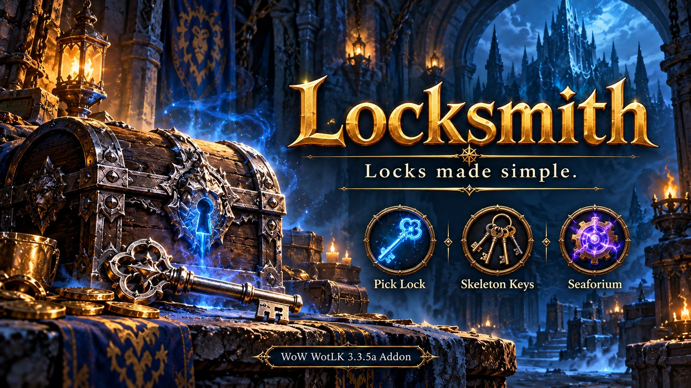

# Locksmith

**Locks made simple.**  Unlocking shortcuts for **World of Warcraft: Wrath of the Lich King 3.3.5a**, covering Vanilla, The Burning Crusade, and Wrath content.

Locksmith brings together Rogue Pick Lock, Blacksmithing Skeleton Keys, and Engineering Seaforium Charges.  Unlock supported bag items with a modifier-click, choose a consumable for a locked world object, or help another player through the trade window.

**No required dependencies.  No action-bar slot needed for Locksmith's controls.**

**Only active for rogues, engineers, or blacksmiths.**  Other characters load only a lightweight eligibility check; the unlocking features and minimap button stay inactive.

## Download

[**Download Locksmith.zip**](https://github.com/SuttonX/Locksmith/releases/latest/download/Locksmith.zip) · [Latest release](https://github.com/SuttonX/Locksmith/releases/latest)

## Bag lockboxes

Hold **Alt** and left-click or right-click a supported locked item.  Choose **Shift** or **Ctrl** instead under **Interface > AddOns > Locksmith**, or open the settings with `/ls config`.

- Rogues use **Pick Lock** when their detected skill meets the lock's requirement.
- Otherwise, Locksmith selects the **weakest suitable usable key or charge** from carried bags and the Blizzard Keyring.
- Rogues with trained Pick Lock but insufficient skill receive a confirmation before using a consumable.
- A highlight and small method icon show the selected action.  The tooltip identifies the spell or item, including the available item quantity.
- Missing or unreadable requirements do not trigger a guessed consumable choice.
- Normal bag clicks keep their usual behavior.  The shortcut is disabled in combat, at vendors, and at the Auction House.

**Banked lockboxes:** Move the lockbox into your carried bags first, then use the modifier shortcut.

## World doors, chests, and footlockers

**Right-click the object normally first.**  Rogues with sufficient skill can use the game's native world-object lockpicking.  Named dungeon and quest keys also keep their normal behavior.

If the game reports a recognized locked error, Locksmith opens a compact window containing your **usable Skeleton Keys and Seaforium Charges**.  Select an item, then click the object.  With no usable consumables available, it displays **“No charges or keys available”** instead of opening an empty window.

World-object skill requirements are not reliably exposed to the addon.  The popup lists available usable consumables; **you choose one strong enough for the lock**.  A special named key may still be required.  Objects or servers that do not send a recognized error may require opening the window manually with `/ls` or the minimap button.

The window opens near the cursor, avoids tooltips where possible, and sizes itself to its contents with a maximum of four columns.  Item quantities appear at the bottom right; totals of 100 or more display `*`, with the exact quantity in the tooltip.  Drag its title to save a position, press **Escape** to close it, or use `/ls reset` to restore cursor-relative placement.

The window closes when the client reports a successful cast of the selected unlocking method.  Failed or interrupted attempts leave it available for another try.  Server event behavior can vary.

## Unlocking for someone else

**Rogues who have learned Pick Lock** can right-click a locked box in the other player's **“Will not be traded”** slot.  Locksmith opens a **Pick Lock-only** window.  Select the spell, click the box, and complete the trade as prompted.

Skeleton Keys and Seaforium Charges are excluded from this popup.  In testing, the game rejected both on trade-slot items with **“Item cannot be enchanted in trade.”**  Non-rogues do not receive a trade popup.

## Supported consumables

- **Skeleton Keys:** Silver, Golden, Truesilver, Arcanite, Cobalt, and Titanium.
- **Seaforium Charges:** Small, Large, Powerful, and Elemental.

Your character must meet the item's profession requirement to use it.  Selecting a consumable still follows the game's targeting, casting, and consumption rules.

## Settings and commands

| Command or control | Action |
| --- | --- |
| `/ls` | Open the consumable window |
| `/ls config` | Open settings |
| `/ls hide` | Close the window |
| `/ls reset` | Reset its saved position |
| `/ls status` | Print detected skill ranks |
| `/ls inspect` | Inspect a hovered bag item after a five-second delay |
| Minimap left-click | Toggle the consumable window |
| Minimap right-click | Open settings |

`/locksmith` and `/su` also work.  The minimap button can be dragged or hidden in settings.  Bag shortcuts and automatic world detection have separate toggles.  Settings are account-wide.

## Installation

1. Close WoW and extract **Locksmith.zip** into `World of Warcraft/Interface/AddOns/`.
2. Confirm the folder is named **Locksmith**, with `Locksmith.toc` directly inside it.
3. Remove the old **SmartUnlock** folder if upgrading from an early test build.
4. Enable Locksmith and log in.  Keep existing Locksmith SavedVariables when updating.

Locksmith activates its main features for **rogues, blacksmiths, and engineers**.  Other characters retain only a lightweight activation check.  Learning a supported profession activates it; reload after unlearning a profession to reevaluate eligibility.

## Compatibility

- Targets the original **3.3.5a client, Interface 30300**.  It is not a Retail or modern Classic addon.
- Supports default bags, with adapters for **ElvUI, Bagnon, AdiBags, and OmniInventory**.  Bag-addon versions can differ; not every adapter has been tested.
- Works with keyboard and mouse and is intended for **ConsolePortLK Enhanced and WoWPadX** setups.  Choose a modifier your controller already provides, such as Shift when LT is mapped to Shift.
- Automatically applies the optional **ElvUI** window and confirmation-button styling.
- Reads localized client names and includes translated tooltips.  Localization coverage has not been verified in-game for every client language.  Settings and some messages remain in English.

Protected actions require your click and obey combat lockdown.  Locksmith does not automatically cast an unlocking method in response to a game error.

## Other addons by SuttonX

- [FormFreedom](https://github.com/SuttonX/FormFreedom): Dismounting and shapeshift cancellation for supported actions.
- [SetupSwap](https://github.com/SuttonX/SetupSwap): Save and switch addon selections, settings, UI layouts, and action-bar setups.
- [SmartTravel](https://github.com/SuttonX/SmartTravel): One travel button for mounts, travel forms, Ghost Wolf, and Hearthstone.
- [Classfix](https://github.com/SuttonX/Classfix): Customize class colors across compatible UI frames and addons.
- [ConsolePortLK Enhanced](https://github.com/SuttonX/ConsolePortLK-Enhanced): Controller UI with improved action bars, satellites, and cooldown displays.
- [Questie TomTom Helper](https://github.com/SuttonX/QuestieAutoTomTom): Automatic Questie waypoints that respect your manual navigation choices.

These are separate, optional projects and are not bundled with Locksmith.

## Feedback

Include your client language, server, class, profession ranks, bag addon, Locksmith version, exact item or world object, and the steps that produced the issue.  Include any Lua error or game error text.

Created by **SuttonX**.
